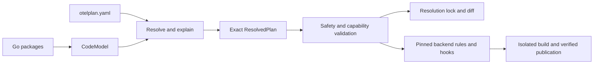

# Architecture

OTelPlan compiles a human-owned policy into exact OpenTelemetry business spans
without changing application source. Discovery is advisory; the reviewed policy
is authoritative. Supported behavior is defined by [CLI](CLI.md),
[policy](POLICY.md), [backend](OTELC_BACKEND.md), and [compatibility](COMPATIBILITY.md).
The [acceptance criteria](14_ACCEPTANCE_CRITERIA.md) remain release-blocking.

## Package boundaries

| Package | Responsibility |
| --- | --- |
| `cmd/otelplan`, `internal/cli` | Signals, caller-owned streams/context, command/flag validation, diagnostics and output. |
| `internal/discovery` | Effective Go inputs, semantic inventory, typed relationships, advisory graph and cache. |
| `internal/suggest` | Deterministic ranking and explained technical-root evidence for initialization. |
| `internal/policy`, `internal/resolve` | Strict policy loading, selectors, exclusions, exact targets and provenance. |
| `internal/validate` | Context, attributes, privacy/cardinality and plan-size checks. |
| `internal/lockfile` | Canonical state, fingerprints, ownership-preserving refresh and drift. |
| `internal/backend/otelc` | Pinned capabilities and deterministic rules/hooks/accessors/bundles. |
| `internal/compiler` | Artifact ownership, isolated modules/workspaces/vendor state, verified execution and publication. |
| `internal/model` | Domain definitions and symbol-ID constructors. |
| `pkg/model` | Existing compatibility aliases/constructor names and canonical parser/error identities. |
| `internal/testenv` | Isolated integration dependencies, network controls and snapshots. |

The adapter uses typed internal functions; a public backend interface is not the
implementation boundary. Policy/resolution does not import backend rule syntax.
New internal types do not expand the compatibility facade. Existing Go imports,
composite literals and interface implementations remain supported, while
`pkg/model` is not a stable SDK commitment. Defining types live in
`internal/model`, including their reflection package identity. Three explicit
parser-only bridges preserve the existing public parser and its error causes.

`CodeModel` describes modules, packages, symbols, types/method sets, source and
context/error metadata, and optional advisory calls. `Policy` describes intent.
`ResolvedPlan` contains exact targets, strategies, attributes, skips and rule
provenance. Locks and artifact manifests have separate ownership; see
[reproducibility](COMPATIBILITY.md#resolution-and-build-ownership).

## Discovery inputs and inventory

Analysis uses `golang.org/x/tools/go/packages`, `go/types`, and typed AST data.
It respects package patterns, the effective toolchain/target, build tags,
module/vendor mode, workspaces, local replacements, and test/dependency inclusion.
Interface matching uses structural method sets for both `T` and `*T`.

Function IDs are `<import-path>.<function>`; method IDs are
`<import-path>.(<receiver>).<method>` or `<import-path>.(*<receiver>).<method>`.
Generic IDs identify declarations without instantiated type arguments; signatures
retain declared parameters and constraints. Inventory records source positions,
visibility, ownership, generated/test flags, parameters/results, context/error
indexes, interfaces and typed registration evidence.

## Entrypoint evidence

Suggestions use `main.main`, statically visible HTTP/gRPC/NATS registrations,
and Connect handler construction as technical roots. Discovery records the API identity
in each exact handler declaration's optional `entrypoints` metadata. It recognizes package
`HandleFunc`/`Handle` calls and the equivalent `ServeMux` methods using Go types,
including import aliases, bound methods, and concrete `Handler` implementations.
Standard `http.HandlerFunc` adapters follow the underlying declaration; custom
function types follow their own `ServeHTTP` implementation. Registration values
such as route patterns are not retained.

For gRPC, discovery reads actual `Server.RegisterService` and
`ServiceRegistrar.RegisterService` calls with a statically known concrete service.
It follows known `ServiceDesc` initializers and the unary/stream handlers' typed
calls to the registered implementation. Wire method names and matching method
signatures alone do not identify application methods. One-level generated-style
registration wrappers are supported when they forward the service parameter
unchanged. Descriptor and handler source can live in an imported dependency;
including dependency symbols in the inventory is not required. Tests exercise
the generated health service from gRPC v1.81.1. Service names, wire names, and
descriptor metadata values are not retained.

For Connect, discovery recognizes the typed unary, client/server-streaming, and
bidirectional handler constructors, including the `Simple` variants. It records
named function and method callbacks and follows one-level generated factories
that bind an unchanged service parameter to a statically known concrete
implementation. Variadic options do not become callbacks. Interface-valued
implementations, changed/address-taken service parameters, anonymous callbacks,
and function fields remain unresolved. Tests use Connect v1.19.1. Procedure and
option values are not retained. Construction is technical evidence, not proof
that a handler is mounted on an HTTP mux or receives requests.

The NATS reader recognizes core and legacy JetStream `Subscribe`/`QueueSubscribe`
methods and the current JetStream `Consumer.Consume`/`PushConsumer.Consume` APIs.
It matches library-owned methods and their actual named callback parameter types,
then maps that parameter to the supplied declaration. Variadic options and method
expressions do not change which argument is the message handler. Subject, queue,
option, and payload values are not retained. This metadata does not infer remote
trace context or add message capture.

Initialization uses the nearest root through statically resolved application
calls, with deterministic provenance when paths tie. HTTP handlers lacking an
explicit context parameter remain outside the default starter targets; eligible
downstream operations receive the additional evidence. Registered gRPC methods
with one explicit context parameter can themselves receive entrypoint evidence.
Streaming methods receiving context only through a stream, and message callbacks
without explicit context, remain outside default starter targets. Eligible
downstream operations can receive static-path evidence from those roots. Policy
remains authoritative.
The metadata does not prove that registration executes or that requests reach a
handler. Conservative call candidates do not become proven static paths.

Mutable function variables, interface-valued callbacks, anonymous handlers, and
indirect HTTP/NATS registration wrappers remain unresolved by this reader. gRPC
interface-valued implementations, dynamically constructed descriptors, reassigned
service parameters, and wrappers beyond the direct forwarding form remain
unresolved. These facts do not prove registration or construction executes; arbitrary descriptor
mutation through aliases or external calls is not modeled. Channel-based and
synchronous message receive loops, encoded callbacks, and other broker APIs have
no registration reader. Recognizers are
private typed-analysis functions; adding integrations does not change policy syntax
or load executable plugins.

## Advisory analysis

Optional SSA/CHA call edges distinguish statically resolved calls from conservative
candidates. Closures are attributed to their enclosing declaration; external
callees are retained without traversing external bodies unless dependencies are
included. Reflection and some generic dispatch can be missing. Edges are sorted
and deduplicated and do not change matching or lock fingerprints.

Basic typed-AST discovery independently marks known static recursion cycles and
recognizable `trace.Tracer.Start` calls. These facts produce policy warnings,
not automatic exclusions or proof of runtime execution. Detailed limits belong
to [policy safety](POLICY.md#recursion).

## Effective build inputs

Explicit `GOFLAGS=-mod=mod`, `-mod=readonly`, and `-mod=vendor` override vendor
detection. Otherwise analysis selects readonly mode, or vendor mode when vendor
metadata exists. Explicit policy tags override ambient tags; order and duplicates
are normalized. Module/workspace manifests are copied into private state before
Go resolution, preserving caller manifests and checksum files.

Supported semantic flags include `-mod`, `-modfile`, `-tags`, `-race`, `-msan`,
`-asan`, `-trimpath`, and `-buildvcs`. Output/cache flags are normalized away.
Unsupported flags, overlays, custom executors and custom package drivers fail
instead of being omitted from analysis/fingerprints. Automatic external driver
discovery is disabled. Go caches may be populated; `--offline` disables dependency
lookup rather than sandboxing arbitrary build-tool code.

## Analysis cache

Caching is opt-in and trusted local state. A lookup reruns package selection and
hashes selected/embedded/dependency sources, manifests, workspace/vendor metadata,
options, effective build inputs and the analyzer executable. Absolute paths are
part of cache identity, so relocation or compiler-generated paths can cause a
miss while the lock fingerprint remains relocatable. Hits avoid syntax/type/SSA
reconstruction. Raw effective environment values are omitted from entries and
restored from the current request.

Entries are bounded to 64 MiB each. Invalid regular payloads trigger analysis;
nonregular opened entries fail through `ErrCacheStorage`. Publication is atomic,
permits concurrent callers and rejects changed inputs. Writable retention counts
only verified SHA-keyed entries, retaining at most 64 files/256 MiB, protecting the
current publication and ordering oldest entries by timestamp then filename.
Unknown, malformed and nonregular entries are preserved and excluded from the
managed budget. Cancellation and concurrent removal retain their documented
storage semantics.

Read-only mode reuses entries without creation, refresh or retention writes.
Missing/obsolete/corrupt regular entries cause fresh analysis; actual storage
failures remain errors with filesystem causes. CLI check, diff and dry-run select
this mode. Private-directory requirements and flags belong in [CLI](CLI.md).

## Build isolation and publication

Compile validates capabilities, generates a standalone pinned runtime, compiles
it, verifies its artifacts and publishes an owned bundle/manifest. Build copies
application modules, workspace members and local replacements into disposable
state; it adds the runtime and verifies application/runtime dependency selection.
Vendor mode regenerates the combined workspace and checks original vendor bytes.
The verified backend builds exact targets; artifacts and backend identity are
checked again before binary publication. Applications configure their own SDK
and exporter; generated hooks install neither.

`build --locked` checks resolution freshness before backend execution. Default
builds permit an absent lock, and neither build nor compile refreshes it. Existing
output must pass ownership/replacement checks. Individual binary publication is
atomic; a later multi-output I/O failure can leave earlier outputs published.
Metadata aliases are protected while ordinary symlink-directory output remains
supported. See [CLI ownership](CLI.md#lock-ownership) and [backend behavior](OTELC_BACKEND.md).

## Design invariants and scope

- Policy is authoritative. Discovery and initializer scores provide deterministic,
  explained suggestions; they do not silently choose production instrumentation.
- Selection uses Go symbols, types, method sets, interfaces, source metadata, and
  explicit policy. Service/Repository names and directory layouts are not required.
- Broad selectors resolve to exact declarations before backend generation.
  Inspect, explain, diff, and locks make selection and drift reviewable.
- Application Go files and module/workspace state remain unchanged. Backend
  execution uses disposable copies; explicit policy, lock, and artifact outputs
  retain their documented ownership and replacement checks.
- Argument/result capture requires explicit mappings. Sensitive-name defaults
  cannot be removed by custom patterns, and capture cannot be enabled wholesale.
- Required context propagation fails validation when it cannot be represented.
  Explicit root strategies and nil-context behavior follow the runtime contract;
  there is no inferred ambient continuation.
- The pinned adapter validates capabilities and exact identities before rendering.
  Unsupported targets fail without partial artifacts or silent uninstrumented fallback.
- Generated spans use OpenTelemetry APIs. Applications own their SDK, exporter,
  transport, and Collector configuration. OTelPlan analysis stays local and the
  CLI installs no telemetry exporter or analytics.
- Policy, lock, CLI JSON, diagnostic codes, and exit categories are the primary
  compatibility contracts. Generation, canonicalization, and diagnostics remain
  deterministic for equivalent inputs. Public Go types require a demonstrated
  consumer need; speculative interfaces and extension points are not release work.

The stable scope excludes arbitrary code-block capture, source-patch generation,
a replacement compiler-weaving engine, vendor-specific transaction APIs, GUI/SaaS
or IDE products, LLM-based inference, and additional backends. Verified limitations
of the current pin belong in the [backend reference](OTELC_BACKEND.md), not in
unimplemented interface proposals. Compatibility and migration commitments belong
in [COMPATIBILITY.md](COMPATIBILITY.md). The [acceptance criteria](14_ACCEPTANCE_CRITERIA.md)
remain mandatory; a green development check does not establish release readiness.

Backend updates must be checked against the exact upstream source, rule schema,
hook API, and real trace tests. Upstream main, design proposals, competitor
comparisons, or issue closure do not establish capabilities of the pinned binary.
